# Iron Skies

**An open-source, photorealistic WW2 combat flight simulator for Linux and Windows.**

Iron Skies aims to combine study-level flight dynamics, a photorealistic rendering
pipeline, persistent maps derived from real-world geodata, and drop-in multiplayer —
with **zero licence fees, zero royalties, and no proprietary dependencies**.

> **Status: pre-alpha / M0.** Nothing here is stable yet. The first playable vertical
> slice is targeted for milestone M2 (see [docs/ROADMAP.md](docs/ROADMAP.md)).
>
> M0 already starts the Spitfire on a marked runway, takes off, flies over a streamed
> 40 × 40 km Normandy terrain with Sentinel-2 orthophoto/landcover, OSM roads,
> hedgerows, woods and extruded buildings around the airfield, two flyable aircraft on
> placeholder airframes, cockpit view, engine
> simulation, procedural audio and four working guns, up to six AI bandits plus AI wingmen,
> hit-zone battle damage
> (engine, controls, fuel) and a live cockpit instrument panel. A committed
> **4,000 × 4,000 km Europe base** built from NOAA ETOPO1 relief and NASA Blue Marble
> imagery provides a continental map; the 40 km Normandy sample is blended over the
> airfield as a sharp inset, and an optional generated **400 × 400 km** North-west France
> layer adds regional detail. Major European rivers are rendered as flowing water
> surfaces, and 17 generated Copernicus GLO-30 **mountain patches** cover the Alps,
> Pyrenees, Scandes, Carpathians, Apennines, Dinarides, Greece, Iberia, Massif Central,
> the UK and Iceland.
> Linux and Windows release packages are configured.


*Launcher: single-player, missions, duel, host-and-play, LAN server browser, settings,
key bindings, or direct connect.*

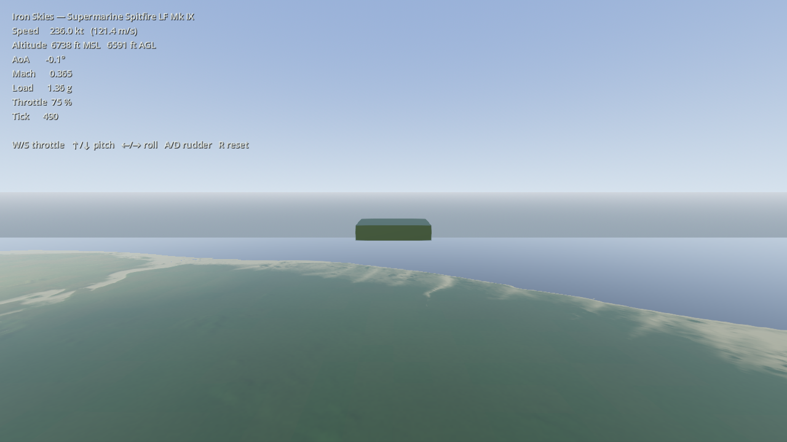

*M0: low-poly Spitfire over 40 × 40 km streamed terrain with Sentinel-2 orthophoto and landcover.*

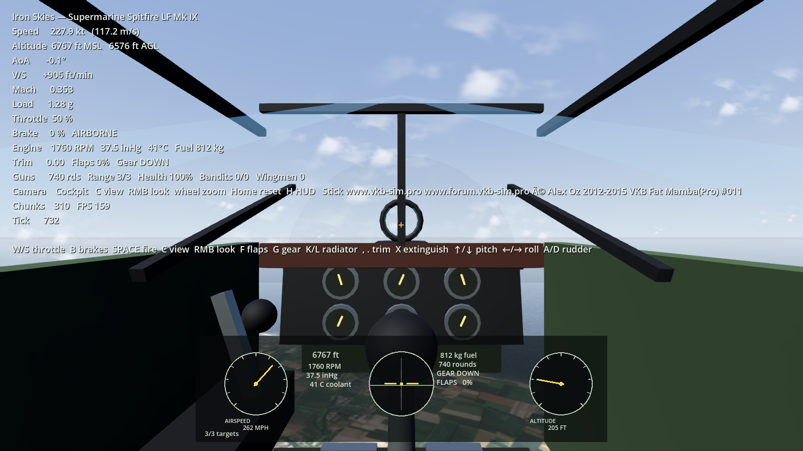

*First-person cockpit with the 3D cabin and instrument panel (C cycles chase → cockpit → top).*

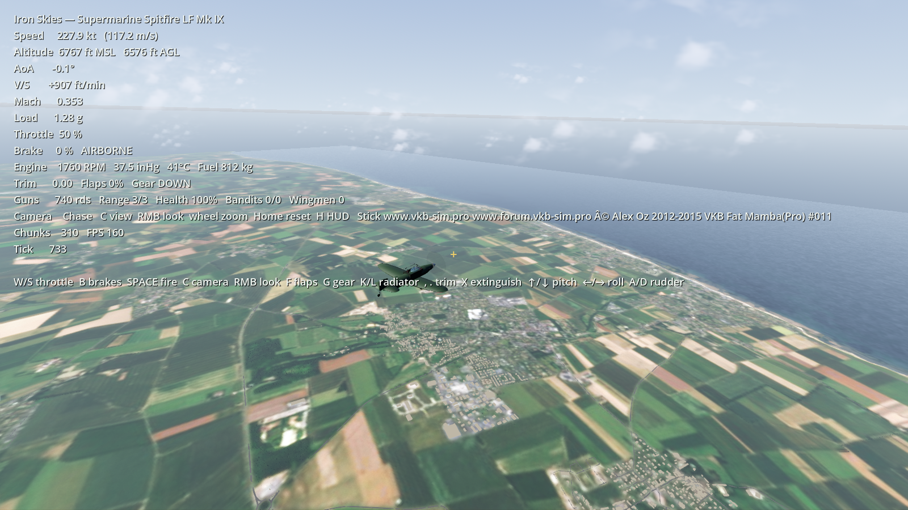

*The chase camera can be orbited with the right mouse button, zoomed with the wheel and
re-centred with Home; the same axes/buttons can be bound on a HOTAS.*

## Theatres

The repository ships two committed bases:

- **Europe — 4,000 km** (≈13 MB): NOAA ETOPO1 elevation at 2 km and NASA Blue Marble
  imagery at ≈1 km/px. This is the continental map.
- **Normandy — 40 km** (≈16 MB): the original Sentinel-2/OSM sample and the sharp
  25 m/10 m airfield layer.

The **400 × 400 km North-west France** layer is generated locally because it is
100× larger than the sample and still uses 50 m height and 98 m imagery:

```bash
python3 tools/mapgen/mapgen.py --theatre france-northwest-1944 \
    --resolution 50 --ortho-size 4096
python3 tools/mapgen/fetch_osm_objects.py \
    --theatre france-northwest-1944 --radius 2000
```

The Europe base can be rebuilt from the same pipeline (ETOPO1 is cached after the first
~323 MB download; imagery comes from NASA GIBS):

```bash
python3 tools/mapgen/mapgen.py --theatre europe-1944 \
    --resolution 2000 --ortho-size 4096 --no-osm
```

The **mountain patches** are generated locally from Copernicus GLO-30: a 400 km square
per range at 50 m height, with Blue Marble imagery. The current catalog is:

- Alps, Pyrenees
- Scandes (south and north)
- Carpathians (west and east)
- Apennines (north and south)
- Dinarides, Pindus/Greece
- Iberia (central), Cantabrian, Sierra Nevada
- Massif Central/Vosges, Scottish Highlands, Wales/Lake District, Iceland

```bash
for id in alps-1944 pyrenees-1944 \
    scandes-south-1944 scandes-north-1944 \
    carpathians-west-1944 carpathians-east-1944 \
    apennines-north-1944 apennines-south-1944 \
    dinarides-1944 pindus-1944 \
    iberia-central-1944 cantabrian-1944 sierra-nevada-1944 \
    massif-central-1944 uk-highlands-1944 \
    wales-lake-district-1944 iceland-1944; do
  python3 tools/mapgen/mapgen.py --theatre "$id" \
      --resolution 50 --ortho-size 4096 --no-osm
done
```

Each patch is ≈123 MB; all 17 together are ≈2.1 GB, generated locally and git-ignored.
The continental lowlands use a 500 m GLO-90 layer:

```bash
python3 tools/mapgen/mapgen.py --theatre europe-500m-1944 \
    --resolution 500 --ortho-size 8192 --no-osm
```

That layer is 8,001² (128 MB) and is loaded over the 2 km base; mountain patches still
win locally. **Mountain patches are streamed:** at most three 400 km ranges stay resident
around the aircraft (load at half extent + 75 km, unload past +125 km), so the 17 ranges
no longer sit in memory at once. An optional 250 m layer (16,001², 512 MB) doubles the
lowland detail and reuses the 500 m imagery:

```bash
python3 tools/mapgen/mapgen.py --theatre europe-250m-1944 \
    --resolution 250 --no-ortho --no-osm
```

A **streamed Sentinel-2 imagery layer** can overlay the lowlands: `tools/build_ortho_tiles.py`
renders 64 km tiles on the same grid, and the runtime stitches the centre 3×3 into a
192 km detail inset (~118 MB) under the 10 m airfield. Missing tiles fall back to Blue
Marble. Generate a region with `--around-east/--around-north --radius`; a 3×3 tile set
takes roughly 40–50 minutes and ≈25 MB. The current local build has a 3×3 set around
the Rhine–Frankfurt lowland (tile 39,27).

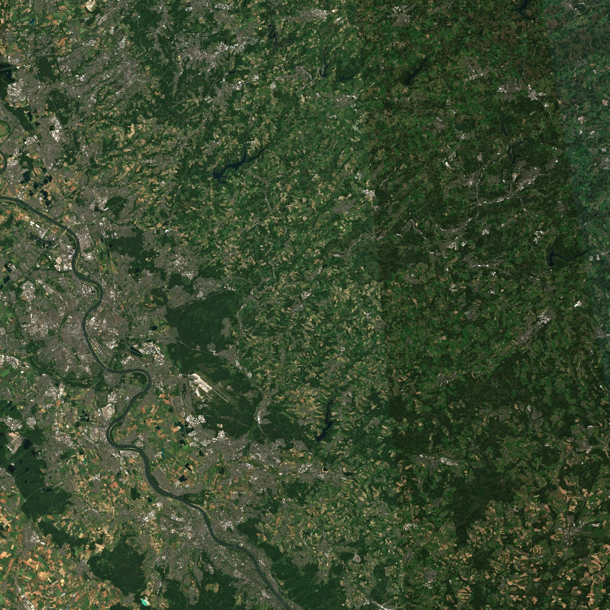

*One 64 km Sentinel-2 tile at 30 m: the Rhine, Frankfurt and the surrounding
fields/forest, streamed under the 10 m airfield inset. Contains modified Copernicus
Sentinel data 2024–2025.*

A **streamed near-field** adds lowland relief around the aircraft: 2,035 land tiles of
64 km, kept in a 3×3 ring, with the outer ring fading back to the continental layer.
The 90 m GLO-90 bundle uses ≈9 MB; the 30 m GLO-30 bundle uses ≈78 MB in memory and is
zlib-compressed on disk (≈5 GB). Release exports carry both; the runtime picks 30 m
when installed, otherwise 90 m.
The 50 m mountain patches still win on top, and the 25 m airfield / 50 m France layers
keep their finer ground.

```bash
python3 tools/build_height_tiles.py --theatre europe-90m-tiles-1944 --workers 8
python3 tools/build_height_tiles.py --theatre europe-30m-tiles-1944 --workers 8
python3 tools/check_height_tiles.py \
    game/assets/terrain/europe-30m-tiles-1944/catalog.json
python3 tools/build_ortho_tiles.py \
    --around-east 500000 --around-north 250000 --radius 1
```

See [docs/plan-europe-heightmap.md](docs/plan-europe-heightmap.md) for the continental
detail plan and `tools/render_heightmap.py` for shaded-relief previews.
They are loaded over Europe when installed; **Single Player** lists every installed range
and spawns airborne over it. Airborne starts begin with **gear and flaps up**. The full
inventory and the next optimisation steps are in
[docs/plan-europe-mountains.md](docs/plan-europe-mountains.md).

Then choose **Settings → Theatre**. The runtime composes these levels on the shared
Europe/Normandy origin:

| Layer | Height | Imagery | Coverage |
| --- | --- | --- | --- |
| Europe base | 2 km | Blue Marble ≈1 km/px | 4,000 km |
| Europe 500 m detail | 500 m | Blue Marble 488 m/px | 4,000 km |
| Europe 250 m detail | 250 m | Blue Marble 488 m/px | 4,000 km |
| Europe 90 m tiles (streamed 3×3) | 90 m | (reuses 500 m) | 64 km each |
| Europe 30 m tiles (streamed 3×3) | 30 m | Sentinel-2 30 m tiles when generated | 64 km each |
| Mountain patches (17, streamed) | 50 m | Blue Marble 98 m/px | 400 km each |
| North-west France | 50 m | Sentinel-2 98 m/px | 400 km |
| Normandy | 25 m | Sentinel-2 10 m/px | 40 km |

For any point it uses the finest layer containing that point, and the shader blends the
ortho insets with feathered edges. Chunk meshes within 10 km stream as before; the base
mesh covers the continent. The tile ring only reloads when the centre 64 km tile
changes, invalidating chunks within 20 km. If a layer is not installed, the runtime
falls back to the layers it has.

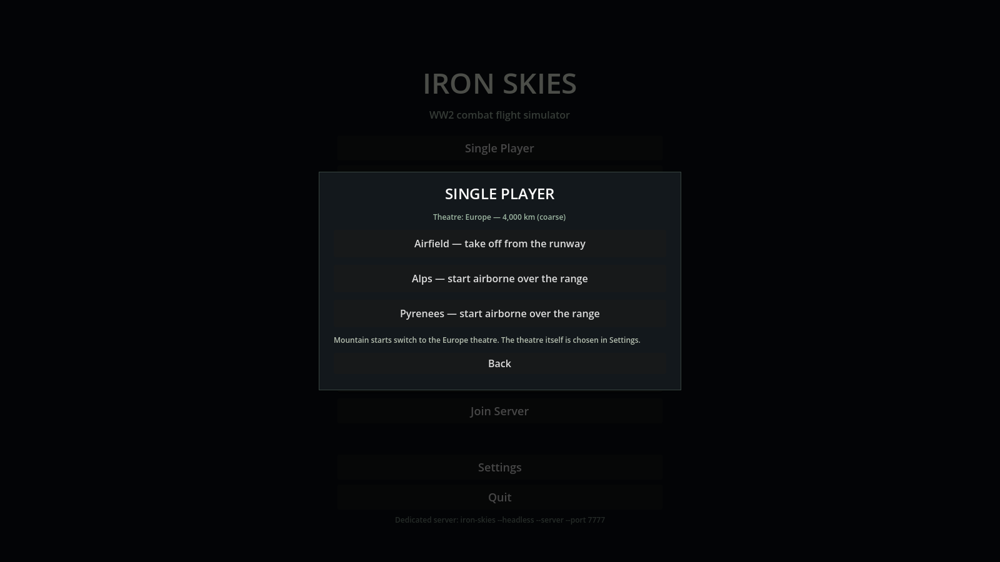

*Single Player asks for a start location — the runway or any installed mountain range.
The start location no longer lives in Settings; the theatre is still chosen there.*

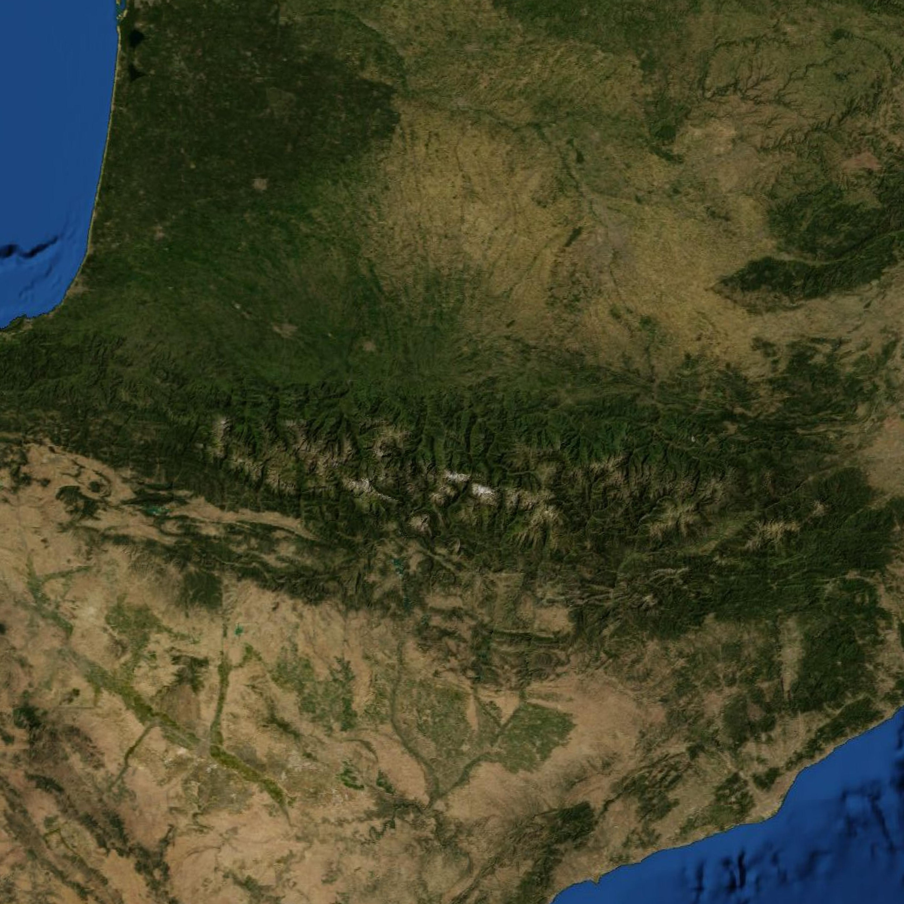

*The generated 400 km Pyrenees layer: GLO-30 height at 50 m over the Europe base, with
Blue Marble imagery.*

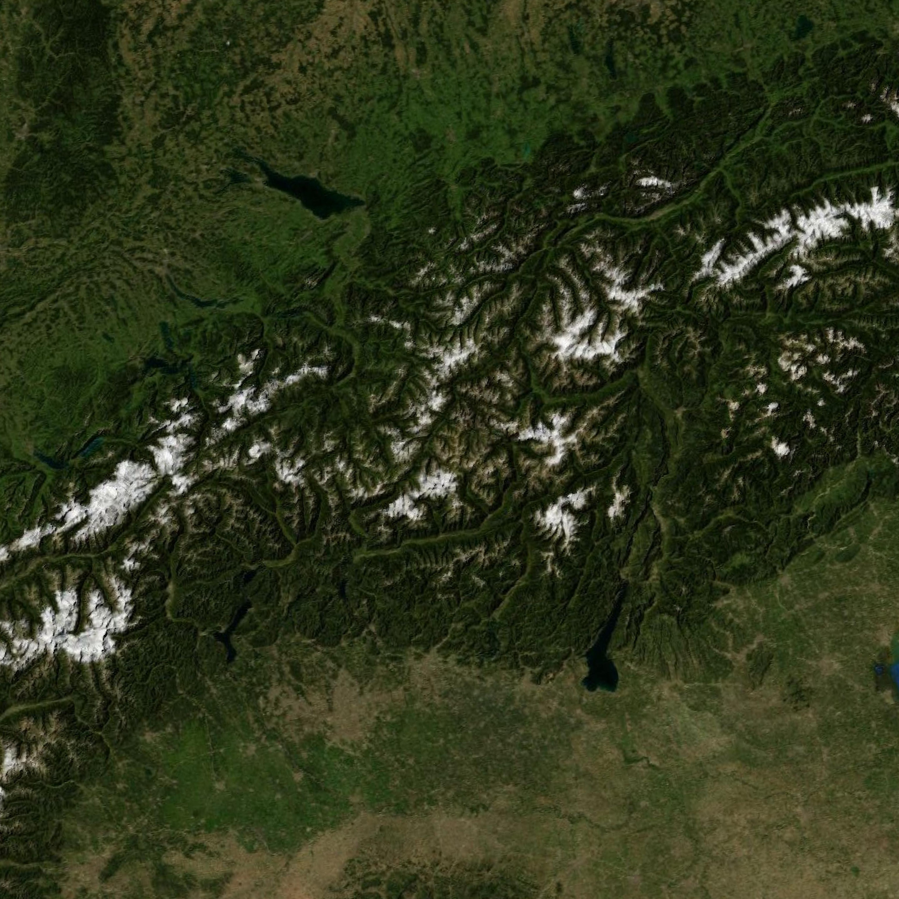

*The generated 400 km Alpine layer: Copernicus GLO-30 height at 50 m over the Europe
base, with the 4,096² Blue Marble ortho. Choose **Single Player → Alps** to spawn
airborne over the range.*

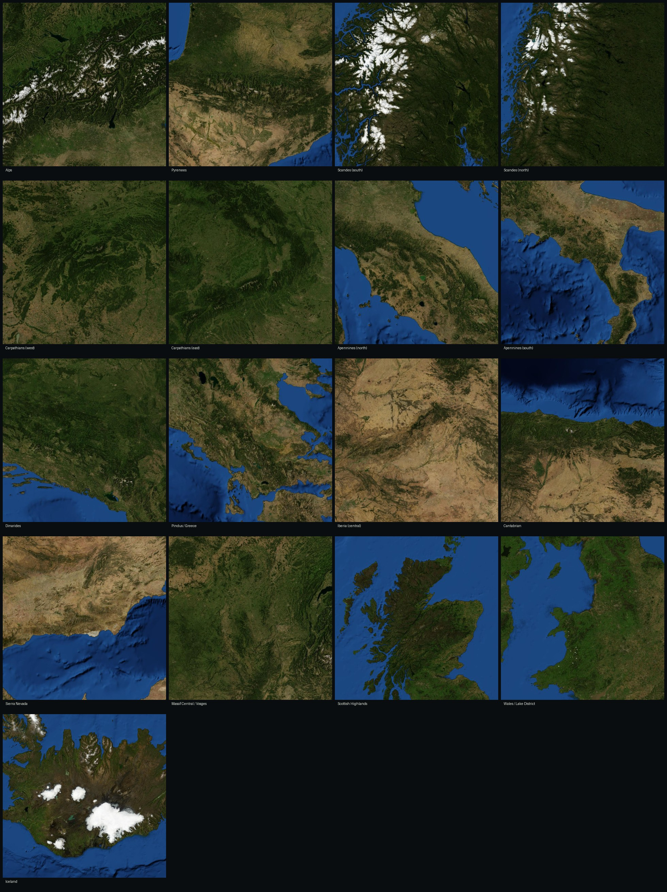

*The full 17-range catalog: each patch is a 400 km GLO-30 height field with Blue Marble
imagery, composited over the Europe base and selectable as an airborne start.*

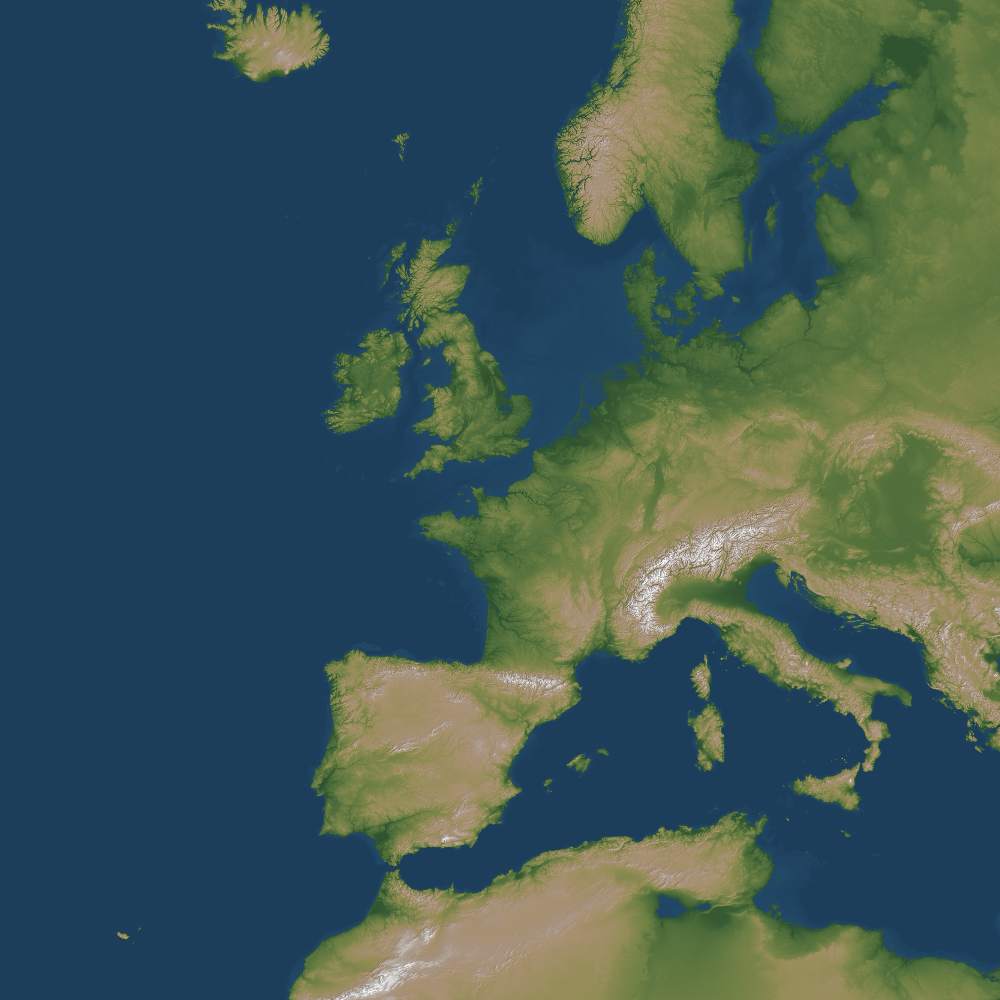

*The Europe-wide 500 m height layer: GLO-90 relief over the 2 km base, with the range
patches still winning at 50 m.*

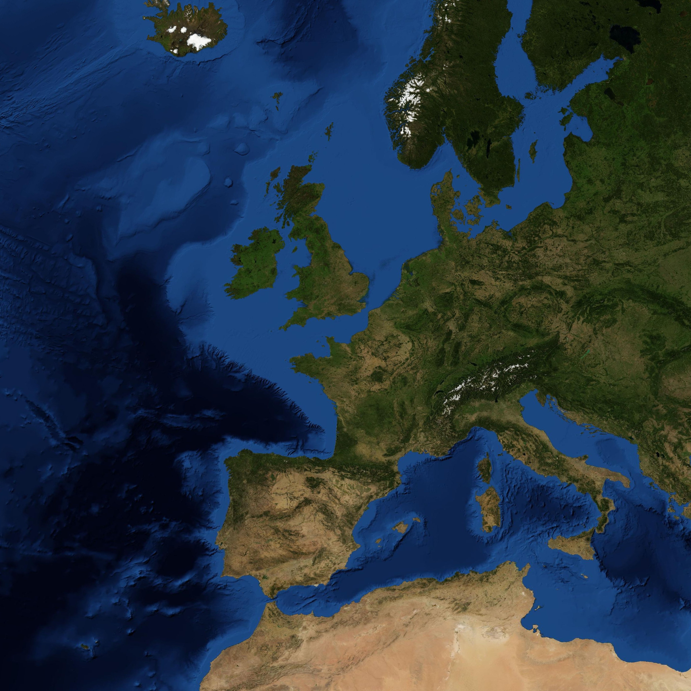

*The committed Europe base: ETOPO1 relief and NASA Blue Marble. In game it is under the
400 km and 40 km detail layers. Source-tiled height/imagery streaming and floating-origin
rebasing are the next steps for full-resolution continental flight.*

## Rivers

Major European rivers are actual flowing water surfaces, not only blue lines in the
orthophoto. **Natural Earth 1:10m** (public domain) supplies 191 major river polylines
across Europe; the local OSM patch adds 18 streams around the airfield. `RiverNetwork`
builds ribbon meshes with UV.y downstream and widths from the data. `river.gdshader`
scrolls two ripple fields along the flow, adds fresnel reflection, edge foam and
view-dependent transparency. `RiverCarver` lowers the terrain into shallow channels, so
the water sits inside the banks instead of on top of the ground.

```bash
python3 tools/mapgen/build_rivers.py
```

The result is `game/assets/water/europe-rivers.json` (≈0.4 MB). The 2 km OSM patch
adds local streams to `osm.json`; the airfield clear zone is excluded from carving.

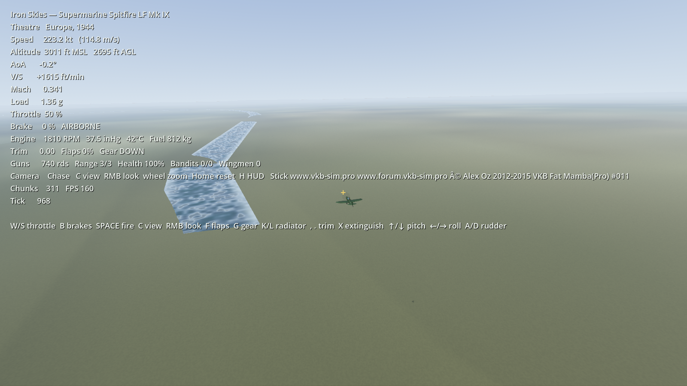

*The Danube near Budapest: 700 m wide in the Natural Earth data, now an animated water
surface in a carved channel with flow-aligned ripples and foam edges.*

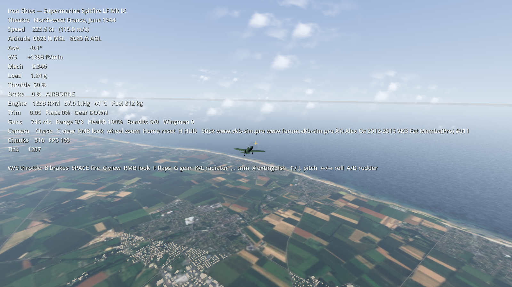

*The generated 400 × 400 km theatre: Normandy, the Brittany coast and the approaches to
Paris. Chunk meshes stream within 10 km; the committed 40 km sample is blended over the
airfield as a sharp 10 m inset.*


*A Bf 109 bandit (placeholder airframe) in a head-on pass, with AI wingmen in support. Hits degrade the engine, controls and fuel tanks.*


*The Bf 109 G-6 is flyable in single-player and multiplayer; the AI flies the Spitfire when you do.*

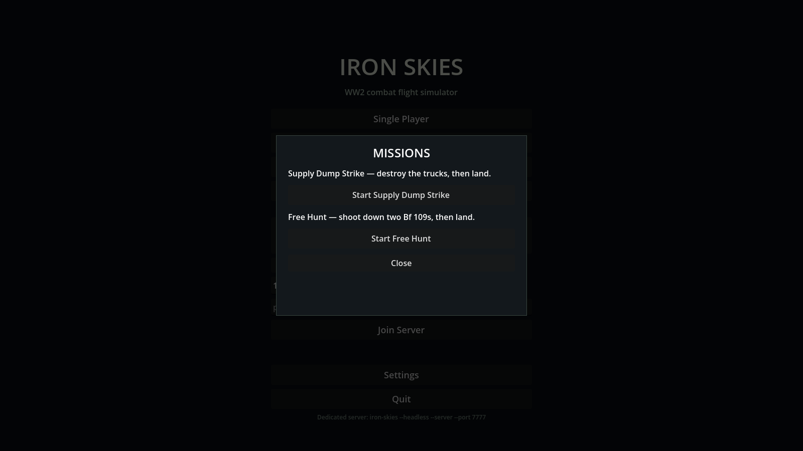

*Three scripted sorties: Supply Dump Strike, Free Hunt and Bomber Intercept. See [docs/missions.md](docs/missions.md).*

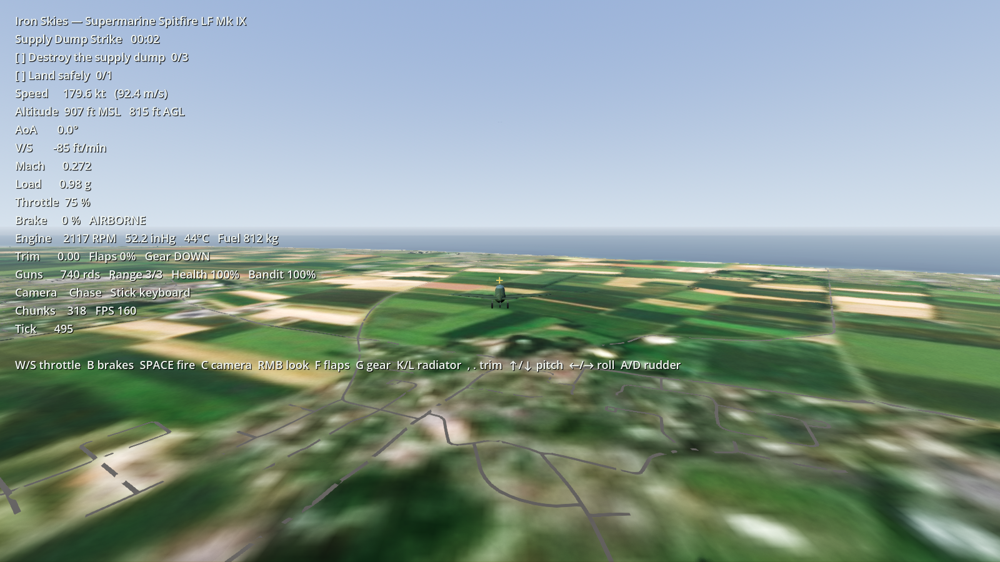

*Supply Dump Strike: destroy the trucks, then land.*

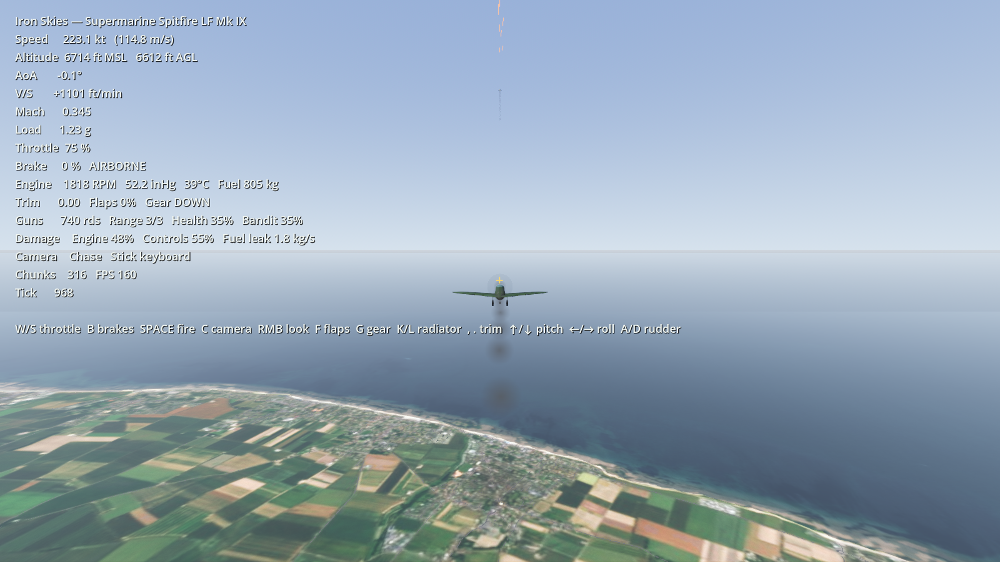

*Battle damage is progressive: engine power, control authority and fuel leaks degrade, and damaged aircraft trail smoke.*


*Free flight starts on a marked strip with a hangar, tower and windsock.*


*OSM woods and extruded buildings around the airfield (2 km OSM API patch).*

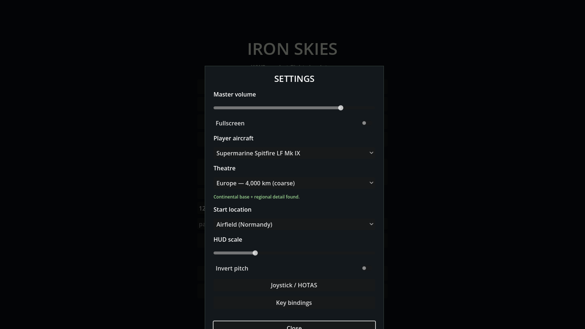

*Settings persist volume, fullscreen, player aircraft, HUD scale, invert pitch and the
full keyboard/HOTAS bindings in `user://settings.cfg`.*

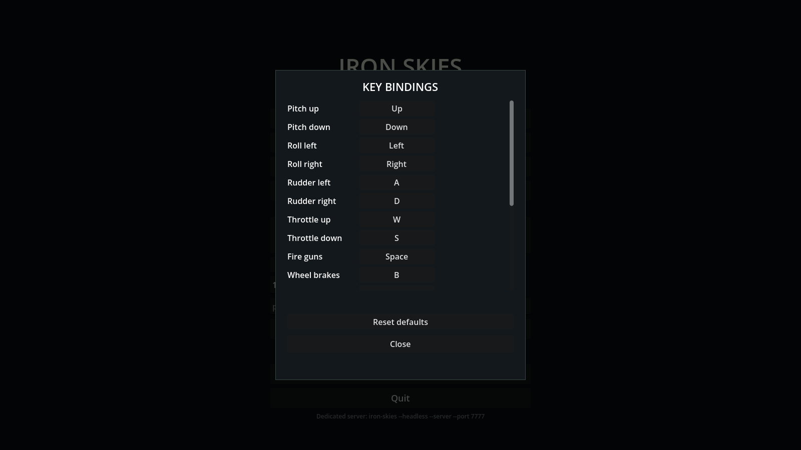

*Every flight control can be rebound; keys are stored in the same settings file.*

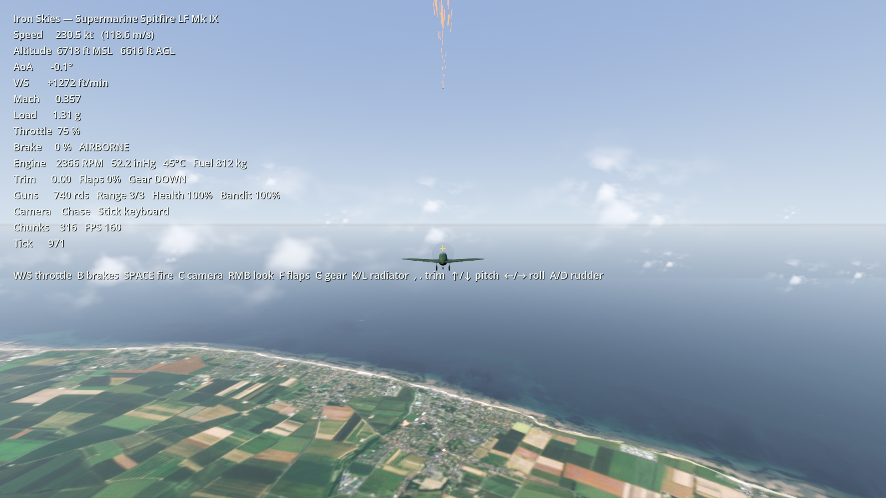

*A procedural cumulus field gives the 40 × 40 km theatre a skyline without any texture assets.*

---

## Why this project

Flight sims in this genre are either decades old, visually dated, or locked behind
proprietary engines with royalty terms. Iron Skies is an attempt to prove that a small
team can ship a credible, good-looking WW2 sim on a fully permissive stack.

## Design pillars

| Pillar | Meaning |
| --- | --- |
| **Authentic** | Aircraft, systems, engines and tactics behave like the real thing, within documented tolerances. |
| **Physical** | A real 6-DOF flight model driven by published aero data — not arcade approximations. |
| **Photoreal** | Scanned PBR materials, physically based sky, volumetric weather, high-density terrain. |
| **Persistent** | Maps are data, not scenes: generated from real DEM/OSM/imagery, stored, versioned and editable. |
| **Open** | MIT-licensed code, CC-licensed assets, reproducible builds, documented formats. |
| **Fast** | 60 FPS at 1080p on a mid-range GPU, 64-player servers on commodity hardware. |

## Stack at a glance

| Layer | Choice | Licence |
| --- | --- | --- |
| Engine | **Godot 4.7** (Vulkan Forward+, Jolt physics) | MIT |
| Simulation code | **C# / .NET 10 (LTS)** | MIT |
| Hot paths (later) | C++ via GDExtension | MIT |
| Flight dynamics | Custom 6-DOF coefficient model, 240 Hz fixed step | MIT |
| Maps / geodata tooling | Python 3 (GDAL, rasterio, numpy, osmium) | MIT/BSD |
| Networking | Authoritative server, ENet, prediction + interpolation | MIT |
| Persistence | SQLite + content-addressed chunk store | Public domain |
| CI / hosting | GitHub Actions, GitHub Releases, Containers | Free tier |

The simulation core measures **0.125 µs per 240 Hz step with zero heap allocations** on
the development machine, so GC pauses never touch the flight path. Policy, benchmarks and
the fallback plan: [ADR-0007](docs/adr/0007-csharp-runtime.md).

Full rationale: [docs/SPEC.md](docs/SPEC.md) and [docs/adr/](docs/adr/).

## Repository layout

```
game/                       Godot project (client + server entry points)
game/assets/aircraft/       Aircraft data sets (JSON + aero CSV + validation)
game/assets/terrain/        Committed 40 km sample; generated regional bundles are git-ignored
src/IronSkies.FlightModel/  Pure .NET 6-DOF flight dynamics (engine-agnostic, unit-tested)
tests/                      xUnit tests for simulation code
tools/mapgen/               Offline geodata -> theatre bundle pipeline
theatres/                   Theatre definitions (generated rasters are git-ignored)
docs/                       Specification, architecture, ADRs
.github/workflows/          CI
```

## Controls

| Input | Action |
| --- | --- |
| W / S | Throttle up / down |
| ↑ / ↓ | Pitch (pull / push) |
| ← / → | Roll |
| A / D | Rudder |
| B | Wheel brakes |
| F | Flaps |
| G | Gear (airborne only) |
| K / L | Radiator closed / open |
| , / . | Elevator trim |
| C | Cycle chase → cockpit → top view |
| Right mouse (chase) | Orbit the camera around the aircraft |
| Right mouse (cockpit) | Look around the cockpit (±77° yaw, ±52° pitch) |
| Mouse wheel | Chase-camera distance |
| Home | Reset view direction and distance |
| H | Toggle HUD |
| Space / left mouse | Fire guns |
| R | Reset sortie |

The demo starts on its gear beside a Normandy hedgerow. Throttle up, keep straight with
rudder, and ease back at ~100 mph to unstick. Bandits patrol about 1.5 km north (`--bandits 0-6`); both
aircraft have 1,000 structural points.

## First takeoff

Free flight starts on the 1.2 km runway. Hold **W** until the throttle reaches 100%,
keep straight with **A/D**, and ease back at **90–100 mph**; the aircraft will lift off
well before the end of the strip. A large prompt stays on screen while you are on the
ground.

## Joystick / HOTAS

Open **Settings → Joystick / HOTAS**. Connected devices are listed at the top; press
**Refresh devices** after plugging one in.

For each action, click its binding button and then move an axis or press a button. You can
bind axes and buttons from **different devices** simultaneously:

- axes: pitch, roll, yaw, throttle, radiator, pitch trim, mixture, brake;
- buttons: fire, brakes, flaps, gear, camera, throttle/radiator/trim increments, fire
  extinguisher, reset.

Camera yaw/pitch axes and camera look buttons can be bound here too, so the view can be
adjusted without leaving the stick.

Each axis has an **Invert** toggle and a **Calibrate** button. Calibrate moves the axis
through its physical range so throttle levers, sliders and asymmetric sticks map cleanly;
**Deadzone** applies to the centered axes. Key bindings remain available as a fallback.


*The HOTAS dialog: any axis or button on any connected device can be bound; calibration
and deadzone are per-axis/global.*

## Quick start (developers)

Prerequisites: .NET SDK 10+, Python 3.11+, Git. Godot 4.7 (.NET build) is needed only
to run the game, not to build/test the simulation library.

```bash
# Simulation library + tests (no Godot required)
dotnet test

# Run the game (launcher: Single Player / Host & Play / Join)
godot --path game

# Direct single-player
godot --path game scenes/Main.tscn

# Capture a deterministic screenshot and exit
godot --path game -- --screenshot /tmp/iron-skies.png

# Record/replay a solo sortie
godot --path game scenes/Main.tscn -- --air-start --record user://sortie.isrp
godot --path game scenes/Main.tscn -- --replay user://sortie.isrp
```

Replays are deterministic and documented in [docs/replay.md](docs/replay.md).

## Multiplayer

Dedicated authoritative server and predicted clients:

```bash
# server (headless)
godot --headless --path game scenes/Multiplayer.tscn -- --server --port 7777

# client
godot --path game scenes/Multiplayer.tscn -- --connect 127.0.0.1 --port 7777
```

30 Hz snapshots, local prediction with snapshot blending, interpolated remote aircraft,
server-owned damage and 5-second respawns. Spitfires and Bf 109s share a server. Up to
**64 players**; measured at **~1.6 MB/s and ~6 ms/tick** with delta, component and fire
snapshots on a shared 16-core machine (worst-case relevance).

```bash
./tools/net_smoke_test.sh        # 2 clients (CI)
./tools/net_load_test.sh 64      # 64 headless clients
```

See [docs/multiplayer.md](docs/multiplayer.md).

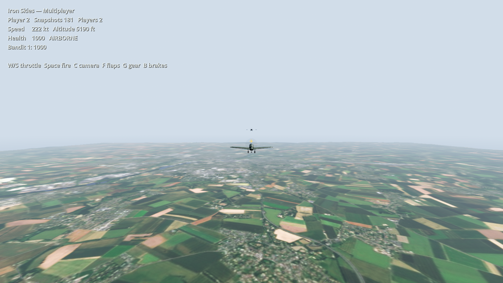

## Packaging

Linux, Windows and dedicated-server presets are committed in
`game/export_presets.cfg`. See [docs/building.md](docs/building.md) for the
export-template setup and `./tools/export_builds.sh`.

Dedicated server:

```bash
./tools/export_builds.sh
docker build -t iron-skies-server .
docker run -d --name iron-skies -p 7777:7777/udp iron-skies-server
```

Servers advertise themselves on the LAN (UDP 7778) and appear in the launcher's browser.
See [docs/dedicated-server.md](docs/dedicated-server.md). A manual GitHub workflow
(`.github/workflows/export.yml`) builds the packages and uploads them as artifacts.

## Contributing

Read [CONTRIBUTING.md](CONTRIBUTING.md) and the [specification](docs/SPEC.md) first.
Good first issues are labelled `good first issue`.

## Licence

Code: [MIT](LICENSE). Original assets: CC BY 4.0 unless a file says otherwise.
Third-party asset and data licences are tracked in [docs/assets-and-licensing.md](docs/assets-and-licensing.md).
