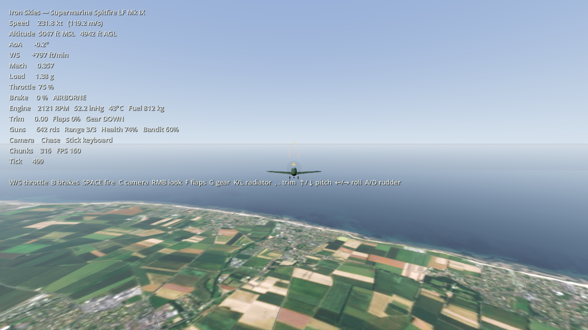

# Iron Skies

**An open-source, photorealistic WW2 combat flight simulator for Linux and Windows.**

Iron Skies aims to combine study-level flight dynamics, a photorealistic rendering
pipeline, persistent maps derived from real-world geodata, and drop-in multiplayer —
with **zero licence fees, zero royalties, and no proprietary dependencies**.

> **Status: pre-alpha / M0.** Nothing here is stable yet. The first playable vertical
> slice is targeted for milestone M2 (see [docs/ROADMAP.md](docs/ROADMAP.md)).
>
> M0 already starts the Spitfire on its gear, takes off, flies over a streamed
> 40 × 40 km Normandy terrain with Sentinel-2 orthophoto/landcover, OSM roads and
> hedgerows, a low-poly aircraft, cockpit view, engine simulation, procedural audio and
> four working guns, a Bf 109 bandit with a pursuit AI, structural damage, and a live
> cockpit instrument panel. Linux and Windows release packages are configured.


*M0: low-poly Spitfire over 40 × 40 km streamed terrain with Sentinel-2 orthophoto and landcover.*


*Cockpit view with the live instrument panel: airspeed, artificial horizon, altimeter, engine, fuel and ammunition.*



*A Bf 109 bandit (placeholder airframe) in a head-on pass. Both aircraft carry structural damage.*

---

## Why this project

Flight sims in this genre are either decades old, visually dated, or locked behind
proprietary engines with royalty terms. Iron Skies is an attempt to prove that a small
team can ship a credible, good-looking WW2 sim on a fully permissive stack.

## Design pillars

| Pillar | Meaning |
| --- | --- |
| **Authentic** | Aircraft, systems, engines and tactics behave like the real thing, within documented tolerances. |
| **Physical** | A real 6-DOF flight model driven by published aero data — not arcade approximations. |
| **Photoreal** | Scanned PBR materials, physically based sky, volumetric weather, high-density terrain. |
| **Persistent** | Maps are data, not scenes: generated from real DEM/OSM/imagery, stored, versioned and editable. |
| **Open** | MIT-licensed code, CC-licensed assets, reproducible builds, documented formats. |
| **Fast** | 60 FPS at 1080p on a mid-range GPU, 64-player servers on commodity hardware. |

## Stack at a glance

| Layer | Choice | Licence |
| --- | --- | --- |
| Engine | **Godot 4.7** (Vulkan Forward+, Jolt physics) | MIT |
| Simulation code | **C# / .NET 10 (LTS)** | MIT |
| Hot paths (later) | C++ via GDExtension | MIT |
| Flight dynamics | Custom 6-DOF coefficient model, 240 Hz fixed step | MIT |
| Maps / geodata tooling | Python 3 (GDAL, rasterio, numpy, osmium) | MIT/BSD |
| Networking | Authoritative server, ENet, prediction + interpolation | MIT |
| Persistence | SQLite + content-addressed chunk store | Public domain |
| CI / hosting | GitHub Actions, GitHub Releases, Containers | Free tier |

The simulation core measures **0.125 µs per 240 Hz step with zero heap allocations** on
the development machine, so GC pauses never touch the flight path. Policy, benchmarks and
the fallback plan: [ADR-0007](docs/adr/0007-csharp-runtime.md).

Full rationale: [docs/SPEC.md](docs/SPEC.md) and [docs/adr/](docs/adr/).

## Repository layout

```
game/                       Godot project (client + server entry points)
game/assets/aircraft/       Aircraft data sets (JSON + aero CSV + validation)
game/assets/terrain/        Sample 40 × 40 km theatre bundle (DEM-derived)
src/IronSkies.FlightModel/  Pure .NET 6-DOF flight dynamics (engine-agnostic, unit-tested)
tests/                      xUnit tests for simulation code
tools/mapgen/               Offline geodata -> theatre bundle pipeline
theatres/                   Theatre definitions (generated rasters are git-ignored)
docs/                       Specification, architecture, ADRs
.github/workflows/          CI
```

## Controls

| Input | Action |
| --- | --- |
| W / S | Throttle up / down |
| ↑ / ↓ | Pitch (pull / push) |
| ← / → | Roll |
| A / D | Rudder |
| B | Wheel brakes |
| F | Flaps |
| G | Gear (airborne only) |
| K / L | Radiator closed / open |
| , / . | Elevator trim |
| C | Cycle chase / cockpit camera |
| Right mouse (cockpit) | Look around |
| Space / left mouse | Fire guns |
| R | Reset sortie |

The demo starts on its gear beside a Normandy hedgerow. Throttle up, keep straight with
rudder, and ease back at ~100 mph to unstick. A bandit patrols about 1.5 km north; both
aircraft have 1,000 structural points.

## Quick start (developers)

Prerequisites: .NET SDK 10+, Python 3.11+, Git. Godot 4.7 (.NET build) is needed only
to run the game, not to build/test the simulation library.

```bash
# Simulation library + tests (no Godot required)
dotnet test

# Run the game (once a Godot .NET build is on PATH)
godot --path game

# Capture a deterministic screenshot and exit (used for art review/docs)
godot --path game -- --screenshot /tmp/iron-skies.png
```

## Multiplayer

Dedicated authoritative server and predicted clients:

```bash
# server (headless)
godot --headless --path game scenes/Multiplayer.tscn -- --server --port 7777

# client
godot --path game scenes/Multiplayer.tscn -- --connect 127.0.0.1 --port 7777
```

30 Hz snapshots, local prediction with snapshot blending, interpolated remote aircraft,
server-owned damage and 5-second respawns. Up to 16 players; measured at
**0.9 ms/tick and ~520 KB/s** server outbound with 16 clients.

```bash
./tools/net_smoke_test.sh        # 2 clients (CI)
./tools/net_load_test.sh 16      # 16 headless clients
```

See [docs/multiplayer.md](docs/multiplayer.md).


## Packaging

Linux and Windows export presets are committed in `game/export_presets.cfg`.
See [docs/building.md](docs/building.md) for the export-template setup and
`./tools/export_builds.sh`. A manual GitHub workflow
(`.github/workflows/export.yml`) builds both packages and uploads them as artifacts.

## Contributing

Read [CONTRIBUTING.md](CONTRIBUTING.md) and the [specification](docs/SPEC.md) first.
Good first issues are labelled `good first issue`.

## Licence

Code: [MIT](LICENSE). Original assets: CC BY 4.0 unless a file says otherwise.
Third-party asset and data licences are tracked in [docs/assets-and-licensing.md](docs/assets-and-licensing.md).
